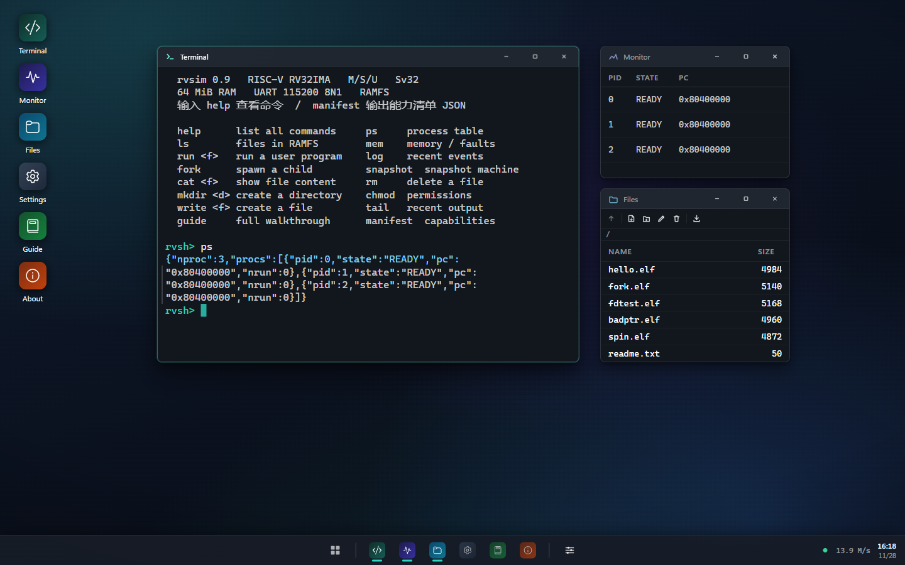
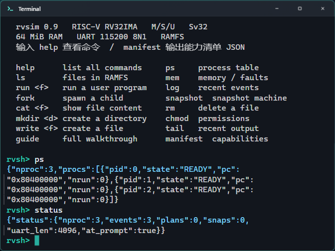
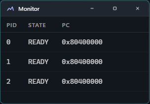

# rvsim

从零写的 RV32IMA 模拟器，上面跑自研迷你内核和浏览器桌面。



| 终端 | Monitor |
|---|---|
|  |  |

## 它做什么

`src/` 是模拟器，2,560 行、16 个文件：RV32IMA + Zicsr/Zifencei 解释执行，自己实现 CSR、trap、
Sv32 分页、总线与设备树加载，解释速度约 25.8 MIPS，能跑 riscv-tests、CoreMark 和 Linux 6.1。
`kernel/` 是迷你内核，6,638 行、20 个文件：M 模式启动，自建页表进 S 模式，`sret` 进 U 模式；
定时器中断驱动抢占调度，缺页按需分配，带 fork、内存文件系统、37 条命令的 shell。
`web/` 是桌面外壳，3,946 行单文件 HTML/CSS/JS，WASM 版在浏览器里直接跑内核，产物 96,935 字节。

内核把自身状态整理成机器可读的形式：`manifest` 输出能力清单（由 `g_caps[]` 生成），`log` 给出
带序号的 16384 条事件环形缓冲，`assert` 直接回答条件是否成立，`snapshot`/`restore` 存档回滚。
AI agent 通过终端操作这台机器时，每一步都能自己核对，不用靠人读日志。用法见 `docs/ai-guide.md`。

## 快速开始

```bash
make deps && make -j4
./build/rvsim --elf tests/riscv-tests/isa/rv32ui-p-add   # 末尾打印 结果：PASS
```

需要 gcc、make、`riscv64-unknown-elf-gcc`，在 Linux 或 WSL 下构建。`make deps` 联网拉
capstone 与 riscv-tests（约 10 MB）；离线与代理做法见 `docs/verification.md`。

## 在终端里用它

```bash
./build/rvsim --elf build/kernel.elf
rvsh> manifest            # 能力清单，JSON，由内核生成
rvsh> run hello           # 跑自带的演示程序
rvsh> assert uart=AAABBBCCC
{"assert":"uart","want":"AAABBBCCC","ok":true}
rvsh> snapshot            # 存快照，返回编号
rvsh> restore 1           # 回滚到快照 1
```

## 功能

| 能力 | 说明 | 状态 |
|---|---|---|
| RV32IMA + Zicsr/Zifencei | 解释执行，约 25.8 MIPS | ✅ |
| M/S/U 三级与 Sv32 | CSR 只有一份存储，S 模式是 M 的掩码视图 | ✅ |
| 抢占式调度 | 定时器中断驱动，3 个进程各跑 37/38/38 次 | ✅ |
| 虚拟内存 | 缺页按需分配，非法地址终止进程 | ✅ |
| shell | 37 条命令：`ps` `run` `mem` `log` `assert` `snapshot` 等 | ✅ |
| 文件系统 | 内存 FS、目录、fd、`>` 重定向、多用户与权限 | ✅ |
| 桌面外壳 | 窗口吸附、61×22 终端、文件管理器、Monitor | ✅ |
| WASM | 浏览器内运行内核，产物 96,935 字节 | ✅ |

## 验证

| 套件 | 规模 | 结果 |
|---|---|---|
| riscv-tests | 82 个官方用例 + 9 个定向用例 | 91/91 |
| 能力契约 `tests/contract.js` | manifest / assert / plan / snapshot 等 | 19/19 |
| 界面 e2e `scripts/ui/e2e.js` | 窗口 / 终端 / 文件 / 进程 / 菜单 / 键盘 | 153/153 |
| QEMU 对照 | CoreMark 四个 CRC、Linux 串口行集合 | 一致 |

```bash
./tests/run_tests.sh all     # 91/91，含能力契约
node tests/contract.js       # 19/19，直接用 web/ 里的 WASM
node scripts/ui/e2e.js       # 153/153，先起 web 静态服务，需要 Node ≥ 20 + playwright
```

上表的数字都由仓库里的脚本产出；口径、复现前提和不能声称的部分见 `docs/verification.md`。

## 设计要点

- **能力清单由内核生成**：`manifest` 的 `caps` 取自 `kernel/main.c` 的 `g_caps[]`，每条能力
  有唯一 key，agent 可以按 key 建索引。
- **事件是真相**：状态变化写进环形缓冲，`replay` 能从事件流重建存活进程，再和 `ps` 交叉验证。
- **界面在内核之外**：内核不画像素，只发布窗口表、终端网格、进程表等结构化数据，宿主负责渲染。
- **QEMU 交叉验证**：CoreMark 与 Linux 启动在两套模拟器上各跑一遍，比 CRC 和串口输出。

## 已知边界

- Linux 镜像不入库，跑 Linux 要自备 `third_party/linux-image/Image`。
- PMP 用例在 `G=0` 下通过，权限位没有真正参与检查。
- 只在 Linux / WSL 构建，Windows 原生缺工具链。
- 界面 e2e 依赖 Node ≥ 20、playwright 与 chromium。
- CoreMark 的 333 iters/sec 按 guest 时间算，墙钟约 80 iters/sec；可信的是四个 CRC。

## 目录结构

```
src/      模拟器：CPU、CSR、trap、Sv32、总线、外设、加载器、反汇编、FDT
kernel/   迷你内核：启动、页表、调度、系统调用、文件系统、shell、能力层
web/      桌面外壳（单文件 index.html）与 WASM 运行时
tests/    riscv-tests、9 个定向用例、能力契约
scripts/  构建、统计、CI、e2e、截图
docs/     规格、对标表、截图、AI 指南、验证口径
bench/    CoreMark 源码节选（16 个文件，只读引用）
dts/      自写设备树
```

截图由 `node scripts/ui/screenshots.js` 生成，需要 playwright。

## 更多文档

- `docs/ai-guide.md`：agent 怎么用这台机器（能力、事件语义、易错点）
- `docs/verification.md`：数字来源、QEMU 对照口径、不能声称的部分
- `docs/ui-spec.md`（549 行，154 项功能）与 `docs/ui-benchmark.md`：桌面外壳的接口与对标
- `docs/CHANGELOG-review.md`：外部评审的修复记录与踩过的坑
